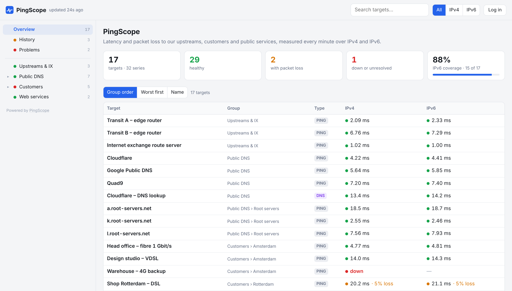
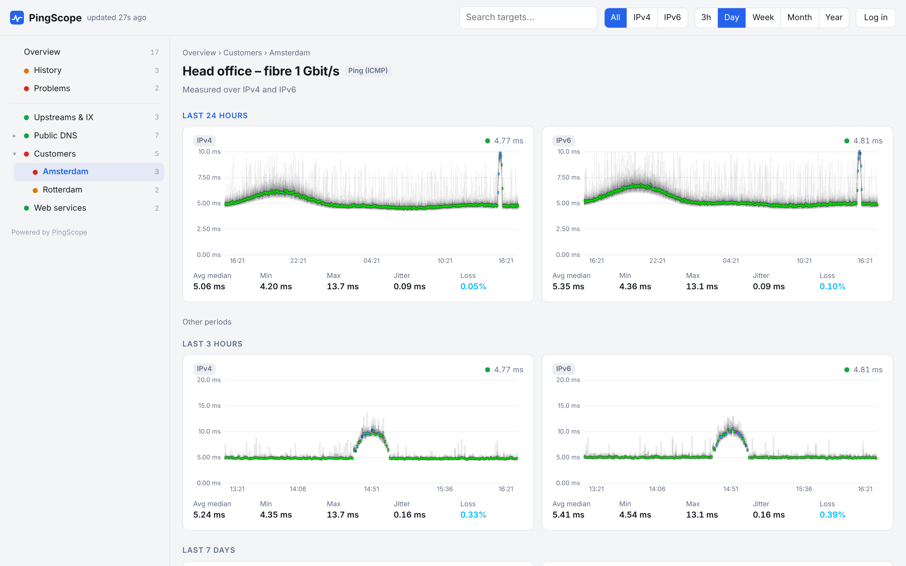
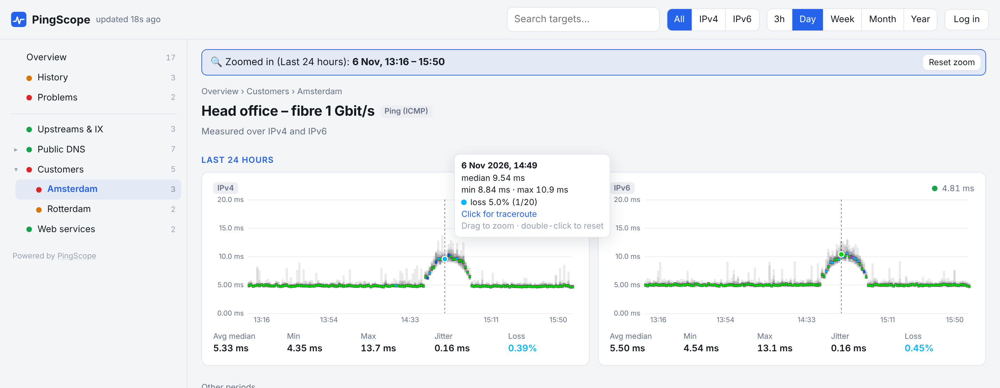
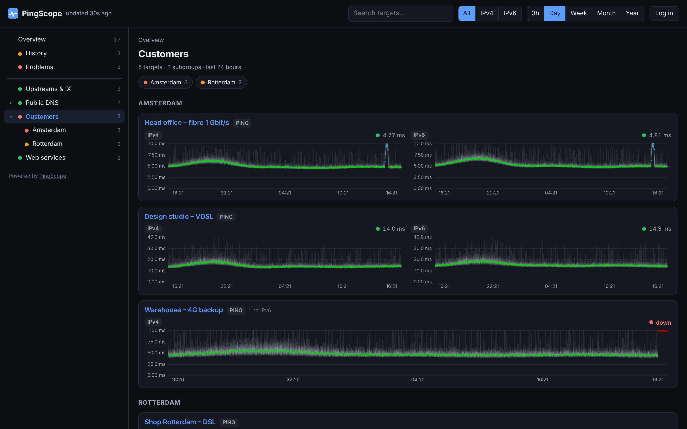
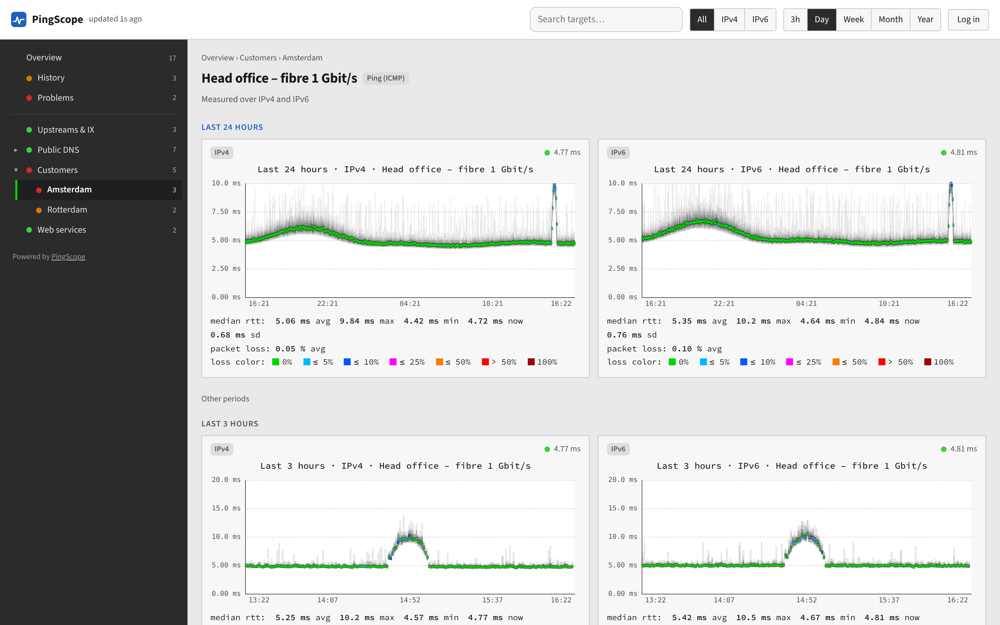
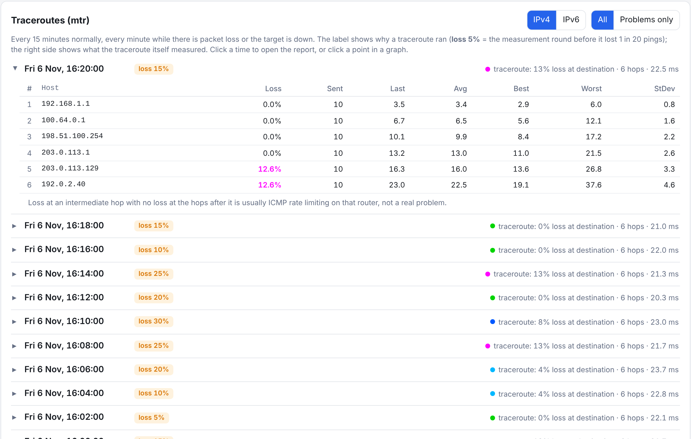
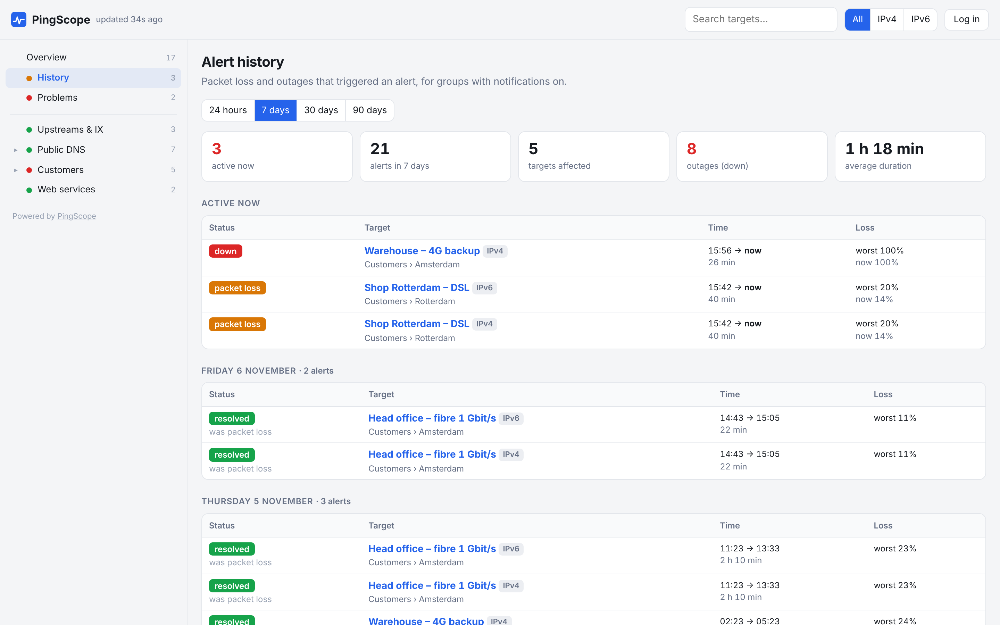
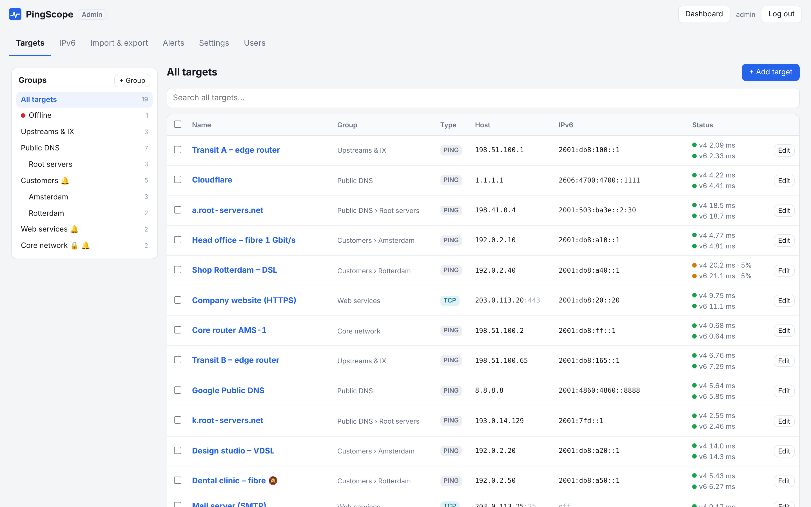
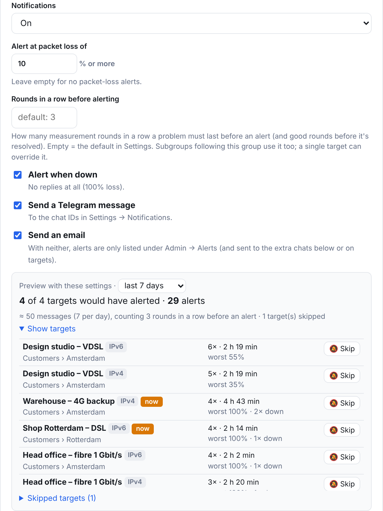
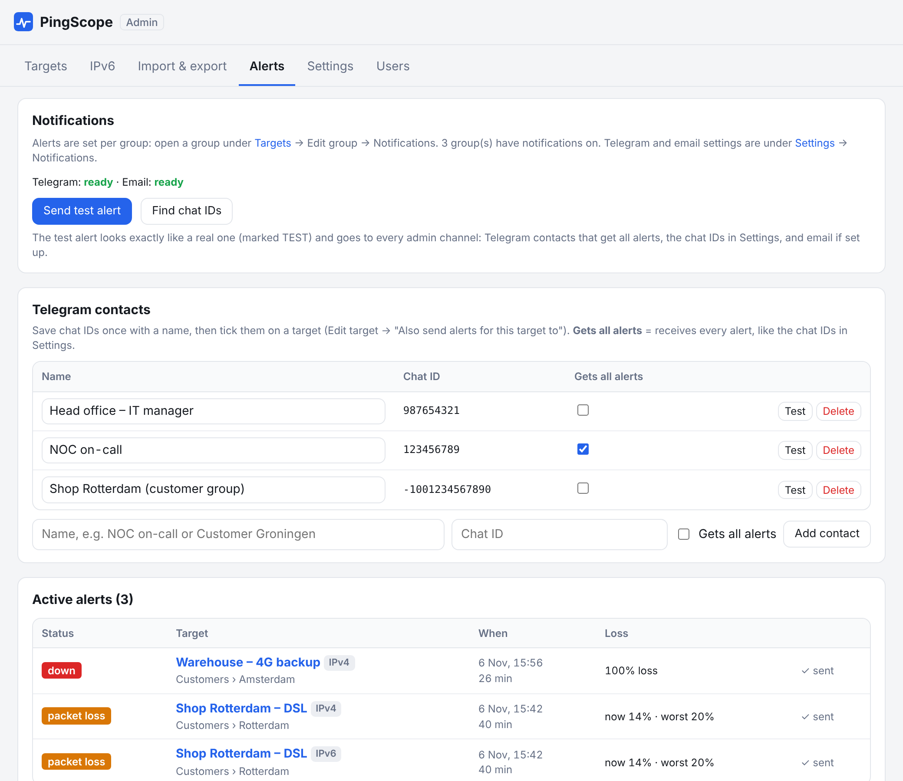

<p align="center">
  
</p>

<h1 align="center">PingScope</h1>

<p align="center">
  <b>Latency and packet-loss monitoring for IPv4 and IPv6, in the spirit of SmokePing, with a modern web admin panel.</b>
</p>

<p align="center">
  <a href="LICENSE"></a>
  
  
  <a href="https://hub.docker.com/r/joebafra/pingscope"></a>
  
</p>

<p align="center">
  <a href="#quick-start">Quick start</a> ·
  <a href="#features">Features</a> ·
  <a href="#screenshots">Screenshots</a> ·
  <a href="docs/INSTALL.md">Install guide</a> ·
  <a href="#configuration">Configuration</a> ·
  <a href="#api">API</a>
</p>



PingScope measures round-trip time and packet loss to your routers, customers, DNS servers and websites every minute, over **IPv4 and IPv6 side by side**. It draws SmokePing-style "smoke" graphs, runs **mtr traceroutes** automatically when something goes wrong, and sends **alerts by Telegram, Pushover and email**. Everything is configured in a web admin panel: no config files to edit, no restarts.

It is a single small Python service with a SQLite database. Install it on a Linux server with one script, and it gets its own **Let's Encrypt HTTPS certificate** and **automatic updates** from GitHub.

## Contents

- [Why PingScope](#why-pingscope)
- [Screenshots](#screenshots)
- [Features](#features)
- [Quick start](#quick-start)
- [Configuration](#configuration)
- [How it works](#how-it-works)
- [API](#api)
- [Command line](#command-line)
- [Adding a probe type](#adding-a-probe-type)
- [Security and privacy](#security-and-privacy)
- [Troubleshooting](#troubleshooting)
- [Contributing](#contributing)
- [Changelog](#changelog)
- [License](#license)

## Why PingScope

[SmokePing](https://oss.oetiker.ch/smokeping/) is the classic tool for this job, and its graphs are excellent. PingScope keeps what makes SmokePing useful and adds what people usually build around it:

| | SmokePing | PingScope |
|---|---|---|
| Graphs | RRD "smoke" graphs rendered on the server | The same smoke and loss colours, drawn in the browser: hover crosshair, drag to zoom |
| IPv6 | A separate target per family (`FPing6`) | One target, IPv4 and IPv6 graphs next to each other; A/AAAA lookups and IPv6 suggestions |
| Configuration | Text config file, reload to apply | Web admin panel; changes apply within a round |
| Traceroutes | Not included | mtr every 15 minutes, every minute during problems, linked from the graphs |
| Alerts | Pattern-based alerts by mail or script | Telegram, Pushover and email per group, with a preview of how many alerts you would get |
| Visitors | One view for everyone | Public dashboard without hostnames or IP addresses (or with them, per group); hidden groups; Admin and Viewer accounts |
| Migration | | Imports your SmokePing `Targets` file |

## Screenshots

| | |
|---|---|
|  **Target page:** IPv4 and IPv6 graphs side by side for every period, with median, min, max, jitter and loss. |  **Zoom and crosshair:** drag across a graph to zoom in; the crosshair follows the same moment on every graph. |
|  **Group page, dark mode:** follows the visitor's light/dark preference. |  **Classic style:** a SmokePing look with framed graphs and the familiar legend. |
|  **Traceroutes:** hop-by-hop mtr reports, labelled with why they ran. |  **Alert history:** active and resolved alerts per day, with duration and worst loss. |
|  **Admin panel:** nested groups, live status, bulk actions, an "Offline" list for cleanup. |  **Alert preview:** see how many alerts a threshold would have given over the last days, before you switch it on. |
|  **Alerts tab:** channel status, test alerts, Telegram contacts and active alerts. | |

<sub>Screenshots use demo data with documentation addresses (192.0.2.0/24, 198.51.100.0/24, 203.0.113.0/24, 2001:db8::/32).</sub>

## Features

### Measurements

- **Three probe types**, each a small plugin:
  - **Ping (ICMP)** with [fping](https://fping.org/): round-trip time and packet loss. All targets of a round are pinged in parallel by one fping process per address family, so hundreds of targets cost very little.
  - **DNS query**: response time of a DNS server for a query (UDP). Choose the query name and record type (A, AAAA, NS, SOA, MX, TXT, CNAME, PTR). Any valid answer counts, including NXDOMAIN.
  - **TCP connect**: time to open a TCP connection to a port (443 by default). Useful for hosts that block ICMP, or to watch a web or mail server.
- **Every minute by default**, with 20 pings of 56 bytes (or 10 DNS queries / TCP connects) per target per round, spaced one second apart. Interval, counts, spacing, timeout and ping packet size are settings.
- **Per-target probe settings:** a target can have its own probes per round, spacing, timeout and packet size (*Edit target → Probe settings*), like a separate probe definition in SmokePing.
- **Interval per group or target:** measure some targets less often, e.g. a gateway every minute and a website every 5 minutes (*Measure every* in the group dialog or under *Probe settings*, in whole rounds). Graphs and alerts follow each target's own rounds.
- **Together or spread:** all targets start at the beginning of each round, or each target gets its own fixed random moment in the round (like SmokePing's `offset = random`), so not everything is sent at once. Set it for all targets and override it per target.
- **DNS problems don't look like outages:** when the A/AAAA lookup of a hostname target fails (the record is gone, or the DNS server times out or fails), PingScope keeps measuring the **last known address for 24 hours**. The target stays up as long as it answers, with a purple **DNS** badge and an explanation on the graph, and a **DNS alert** is sent. After 24 hours without a working lookup the target is shown as **down** (with a down alert). The last known address is kept in the database, so a restart during a DNS problem doesn't matter. A target whose IPv6 was removed on purpose: set it to *IPv4 only*.
- **Honest data:** when a probe can't run locally (fping missing, no IPv6 on the server, out of processes), the round is left as a gap instead of being recorded as 100% packet loss, and the error is shown in the admin panel.
- **"Test now"** in the target dialog runs the probe immediately and shows the result, before you save.

### IPv4 and IPv6 side by side

- A target is measured over **IPv4 and IPv6 at the same time**, and both graphs are shown next to each other. Per target you choose *IPv4 + IPv6*, *IPv4 only* or *IPv6 only*.
- **Hostnames** are resolved for A and AAAA records, and looked up again every 5 minutes. If a hostname stops resolving, its graph stays visible (marked unresolved) instead of silently disappearing.
- An IPv4 target can be given an **extra IPv6 address** for the same service. **Find AAAA** in the target dialog suggests one.
- **Admin → IPv6** lists every target that is still IPv4-only, looks up AAAA records for its hostname (and hostnames in its name, like `ns1.example.nl`), and lets you apply the suggestions you trust in one go.
- The overview shows your **IPv6 coverage**: how many targets are measured over IPv6.

### SmokePing-style graphs

- **Grey "smoke"** shows the spread of all probes in a round; the **median line** changes colour with packet loss, using the SmokePing loss colours (0%, ≤5%, ≤10%, ≤25%, ≤50%, >50%, 100%).
- **Periods:** last hour, 3, 6 and 12 hours, day, week, month and year; choose which ones are offered in *Settings → Periods*. A target page shows every period, the one you picked first: with one IP family selected (IPv4 or IPv6 in the header) in two columns like SmokePing's target page, with both families IPv4 and IPv6 next to each other per period.
- **Synced crosshair:** hover over a graph and a dashed line shows the same moment on every visible graph (IPv4 and IPv6 together), with a tooltip: median, min, max and loss of that round.
- **Drag to zoom:** drag across a graph to zoom all graphs of that period into the selected time. Double-click or *Reset zoom* to go back. Zoomed graphs use full-resolution data where available.
- **Click a point** in a graph to open the traceroute closest to that moment.
- **Readable axes and a grid**, like SmokePing: the Y axis in round steps (1, 2 or 5 × 10ⁿ ms) with as many lines as fit, the time axis marked at round times (00:00, 06:00, Mondays, the 1st of a month), and grid lines for both. The top follows the bulk of the pings instead of the single highest spike, and a steady 8 ms line doesn't start at 0, so graphs aren't mostly empty space.
- Under every graph: **average median, min, max, jitter and loss** for that period, and the probe used, like SmokePing: *probe: 20 ICMP Echo Pings (56 Bytes) every 60 seconds*.

### Dashboard

- **Overview** of all targets with the current latency and loss per family, sortable by group order, worst first or name, plus tiles with totals: healthy, with packet loss, down, IPv6 coverage.
- **Problems**: only the targets with packet loss or no replies in the last round.
- **History**: active and resolved alerts per day for the last 24 hours, 7, 30 or 90 days, with duration, worst loss and totals.
- **Nested groups** in the menu, each with a status dot and target count; group pages show small graphs for every target in the group and its subgroups.
- **Search** (press <kbd>/</kbd>), an **IPv4 / IPv6 / both** filter and the period buttons in the header. Your choices are remembered in the browser.
- **Light, dark or system:** a switch in the header lets every visitor pick light, dark or "follow the system"; the choice is remembered in their browser and also applies to the admin panel.
- **Two styles:** *Modern* (default, with light and dark mode) and *Classic*, a SmokePing-style look with a dark menu, framed graphs, a title above every graph and the median rtt / packet loss / loss colour legend below it.
- **Your own branding:** site title and welcome text.
- **Time zone:** times follow each visitor's browser, or the server's time zone for everyone (*Settings → Time zone*). Handy when browsers report UTC because of privacy settings.
- The **version** and commit of the running build in the footer, for example *PingScope 0.011 · 7a91fea*. The commit links to [CHANGELOG.md](CHANGELOG.md), which lists what changed per version and the commit of each version.
- Works on phones: the menu becomes a drawer and tables collapse.

### Traceroutes (mtr)

- [mtr](https://github.com/traviscross/mtr) runs per network path (address family + address) **every 15 minutes**, and **every minute while a target has packet loss or is down**, so you have the path at the moment of the problem.
- Each report is labelled with **why it ran** (*scheduled*, *loss 5%*, *down*) and shows what the traceroute itself measured: loss at the destination, hop count, latency.
- Hop-by-hop table with loss, sent, last, average, best, worst and standard deviation per hop.
- **Reverse DNS names** (PTR) after every hop address, IPv4 and IPv6, looked up after the traceroute with a cache, so a slow resolver never delays it.
- Filter on **problems only**, load older reports, or click a point in a graph to jump to the nearest report.
- A limit on parallel mtr processes keeps the server responsive during a large outage. History is kept for 30 days.

### Alerts: Telegram, Pushover and email

- Notifications are set **per group** (subgroups can follow their parent): alert at a **packet-loss threshold** (for example 10% or more), when a target is **down** (no replies at all), or both. Hostname targets also get a **DNS alert** when their lookup fails for *N* rounds (see *DNS problems* under [Measurements](#measurements)), and a message when DNS works again.
- Delivery by **Telegram** (your own bot), **[Pushover](https://pushover.net)** and/or **email** via [Lettermint](https://lettermint.co). Each can be switched on per group.
- **No alert storms:** a problem must last *N* rounds in a row before an alert starts (default 3), and *N* good rounds before it counts as resolved. *N* can be set per group and overridden per target (1 for a critical link, 5 for a flaky one).
- Everything that starts, gets worse or ends in the **same round goes out in one message**, so a large outage sends one message instead of hundreds. A host that is measured twice (for example a ping target and a DNS target for the same name server, or the same host in two groups) gets **one line** with the worst state and both measurements.
- Optional **"resolved"** messages and **reminders** every *X* hours while a problem lasts.
- **Alerts for customers:** save Telegram chats as named **contacts**, then pick them on a target or a whole group ("Also send alerts for this target to"). Those chats only get messages about their own targets, without your group names.
- **Preview before you switch it on:** the group dialog replays the stored measurements and shows how many targets would have alerted over the last 24 hours, 7 or 14 days, how many alerts and roughly how many messages per day, with a **Skip** button per target.
- **Skip single targets** that should never alert (🔕), from the target dialog, the preview or as a bulk action.
- **Test alerts** that look exactly like real ones (marked TEST), to all admin channels, to one contact, or to the chats picked on a target.
- **Find chat IDs** lists the chats that recently wrote to your bot, so you don't have to look IDs up.
- Active alerts and 90 days of history are listed in **Admin → Alerts**; visitors see the history on the dashboard.

### Admin panel

- **Targets:** nested groups and subgroups, drag targets onto a group to move them, ↑ ↓ ordering or automatic A → Z (natural) sorting per group, bulk actions (move, enable, disable, alerts on/off, delete), search over names, addresses, query names and notes.
- **Offline** list: targets that got no reply at all, or whose hostname no longer resolves, with how long they have been offline and a filter (offline for at least 1 hour / 1 day / 7 / 30 days). Handy for cleaning up old customer connections.
- **Per target:** probe type, host, extra IPv6 address, families, DNS query and record type, port, probe settings (probes per round, spacing, timeout, packet size, together or spread, measure every N rounds), mtr on/off, enabled, alert overrides, extra Telegram chats and a private note.
- **Groups** can be **hidden from visitors**: the group, its subgroups and their targets only exist for logged-in users.
- **Show IP addresses to visitors** per group (off by default): visitors then see the host and the IPv4 and IPv6 addresses of the targets in that group and its subgroups, also as the destination in traceroutes. Single targets can opt out with *Don't show this target's addresses to visitors*. Groups that show addresses get a 🌐 in the group list.
- **Import & export:** SmokePing import with preview, JSON export and import of groups, targets and settings, optionally **with the measurement history** to move to another server without losing your graphs.
- **Settings** apply without a restart, with warnings for combinations that don't fit (for example rounds that would overlap). A status card shows the last round and whether fping and mtr are installed, and an **HTTPS / SSL** card shows per hostname who issued the certificate, when it expires and whether HTTP redirects to HTTPS.
- **Users** with two roles: **Admin** (full access) and **Viewer** (view-only: sees the dashboard with hostnames, IP addresses, traceroute hops and hidden groups, but can't change anything). Every user can change their own password.

### Import from SmokePing

Paste your SmokePing `Targets` section (or a whole config file, or upload it) in **Admin → Import & export**, click **Preview**, then **Import**:

- Nested groups (`+`, `++`, `+++`) become groups and subgroups, using `title` as the name.
- `probe` is inherited like in SmokePing: `FPing` → ping, `FPing6` → ping over IPv6 only, `DNS` → DNS (with `lookup` and `server`), `TCPPing` → TCP.
- Your own probes from the `*** Probes ***` section (for example `++ FPingGateway` under `+ FPing`) are understood too: their `pings`, `packetsize`, `timeout`, `hostinterval` and `offset = random` become the probe settings of the targets that use them. A probe `step` that is a multiple of the 60 s interval (e.g. `step = 300`) becomes *measure every 5 rounds* on its targets.
- **Paste the `*** Probes ***` section along with the targets**, or the probe settings are unknown. SmokePing often keeps it in a separate file (`@include /etc/smokeping/config.d/Probes`); included files can't be read, so paste their contents. A probe that isn't defined is recognised by its name (`FPingFast` → ping, `FPing6Slow` → ping over IPv6, `DNSQuad9` → DNS, `TCPPing443` → TCP) and imported with the default settings, with one warning per probe.
- SmokePing's `forks` and `concurrentprobes` aren't needed: every round all targets are measured in parallel (see [How it works](#how-it-works)). `mininterval` is ignored; fping waits 5 ms between packets to different hosts.
- The known IPv6 addresses of the **root servers and large public resolvers** (Google, Cloudflare, Quad9, OpenDNS, NextDNS) are added automatically, so they're measured over IPv6 right away.
- The preview shows the resulting tree and points out outdated addresses and duplicate targets.
- *Add to existing* reuses groups with the same name and skips identical targets; *Replace everything* starts fresh.

Afterwards, **Admin → IPv6** finds AAAA records for the targets that are still IPv4-only. An example config is in [`examples/smokeping-example.txt`](examples/smokeping-example.txt).

### Export, with or without measurement history

**Admin → Import & export → Export** downloads all groups, targets and settings as JSON. Tick **Include measurement history** to also get the measurements behind the graphs (per round for the last 14 days, hourly summaries for older data), the traceroutes and the finished alerts, as one compressed file (`.jsonl.gz`). Import that file in the same screen on another PingScope server, or on this one after *Replace everything*:

- Targets get new ids; the history follows them. With *Add to existing*, the history of targets that already exist is added to theirs, and measurements that are already there are kept, so importing the same file twice adds nothing.
- API tokens, users and sessions are never part of an export. To move absolutely everything (including users), copy the database instead (`python -m pingscope backup`, see [INSTALL](docs/INSTALL.md#backups)).
- A file is roughly half the size of the database. For very large histories the command line avoids a browser upload: `python -m pingscope export --history FILE.jsonl.gz` and `python -m pingscope import FILE.jsonl.gz`.

### Deployment

- **One installer** (`install.sh`) for Ubuntu and Debian: installs Docker, asks for your hostname and email, checks DNS and IPv6, opens the firewall, starts everything and prints a one-time setup code for the first admin.
- **HTTPS out of the box:** [Caddy](https://caddyserver.com/) gets a Let's Encrypt certificate for your hostname, renews it, redirects HTTP to HTTPS and sends HSTS.
- **Automatic updates:** a systemd timer checks GitHub every 5 minutes. A new version is installed with a **database backup first**, a health check afterwards, and an **automatic rollback** if it doesn't start.
- Runs with **Docker Compose** (recommended) or as a plain **systemd** service, behind Caddy, nginx, Apache or any other reverse proxy.
- A ready-made **Docker image** for amd64 and arm64 on [Docker Hub](https://hub.docker.com/r/joebafra/pingscope), built automatically from `main` and from every release.
- Small: 1 vCPU and 1 GB RAM is plenty for a few hundred targets.

## Quick start

You need a Linux server (Ubuntu 22.04/24.04 or Debian 12) with a public IPv4 address, ideally IPv6, and a hostname whose A (and AAAA) record points to it. Ports 80 and 443 must be reachable.

```bash
sudo git clone https://github.com/joebafra/PingScope.git /opt/pingscope
```

```bash
cd /opt/pingscope && sudo ./install.sh
```

The installer asks for your hostname, email and port (8080, or another one if that's taken, for example by a UniFi controller), sets up Docker, the **Let's Encrypt certificate** (with HTTP→HTTPS redirect), the firewall and automatic updates, and prints a **setup code**. Open `https://<your-hostname>/admin`, enter the code and create your admin account. Then add targets, or import your SmokePing config.

- Full guide, including installing without Docker and using another reverse proxy: **[docs/INSTALL.md](docs/INSTALL.md)**
- HTTPS details and changing the hostname: **[HTTPS / SSL](docs/INSTALL.md#4-https--ssl-certificate-lets-encrypt)**
- Telegram, Pushover and email: **[Notifications](docs/INSTALL.md#4a-notifications-telegram-pushover-and-email)**
- Updates, backups and useful commands: **[section 5](docs/INSTALL.md#5-updating-backups-and-useful-commands)**

### Docker image

The image [`joebafra/pingscope`](https://hub.docker.com/r/joebafra/pingscope) on Docker Hub runs PingScope on any Linux machine with Docker, for a quick try or behind your own reverse proxy:

```bash
docker run -d --name pingscope --restart unless-stopped \
  --network host --cap-add NET_RAW \
  -v pingscope-data:/data -e TZ=Europe/Amsterdam \
  joebafra/pingscope:latest
```

```bash
docker logs pingscope 2>&1 | grep "setup code"
```

Then open `http://<server-ip>:8080/admin`: plain HTTP by IP address works out of the box, no hostname or certificate needed. Use that on a trusted network (LAN, VPN) only, because the login isn't encrypted; for HTTPS use the installer above or your own reverse proxy with `PINGSCOPE_LISTEN=127.0.0.1`.

Host networking lets PingScope measure with the machine's own IPv4 and IPv6 (this needs a Linux Docker host), and `NET_RAW` is needed for ping and mtr. Tags: `latest` (newest on `main`), a version such as `0.011` for each release, and `sha-<commit>`. More on the [Docker Hub page](https://hub.docker.com/r/joebafra/pingscope).

To update, fetch the new image and recreate the container (`docker compose pull && docker compose up -d`, or `docker pull joebafra/pingscope:latest`, `docker rm -f pingscope` and the same `docker run` again). Your data in the volume is kept. Every change on GitHub is published as a new `latest` within a few minutes.

To build the image yourself instead:

```bash
git clone https://github.com/joebafra/PingScope.git && cd PingScope && docker compose up -d --build
```

Without a `.env` file Caddy isn't started and PingScope listens on `127.0.0.1:8080` only.

### Run from source

```bash
sudo apt install -y fping mtr-tiny python3-venv
```

```bash
python3 -m venv venv && venv/bin/pip install -r requirements.txt
```

```bash
PINGSCOPE_LISTEN=127.0.0.1 venv/bin/python -m pingscope
```

The database is created at `data/pingscope.db`; the setup code is printed in the log.

## Configuration

### Settings in the admin panel

Everything about what and how PingScope measures is set in **Admin → Settings** and stored in the database. Changes apply without a restart.

**Site**

| Setting | Default | Range | What it does |
|---|---|---|---|
| Site title | `PingScope` | | Shown in the header and browser tab. |
| Welcome text | | | Shown at the top of the overview page. |
| Dashboard style | Modern | | *Modern* follows the visitor's light/dark preference; *Classic* is SmokePing-style. |
| Show icons | on | | Small line icons next to labels (lock for hidden groups, bell for notifications, globe for groups that show IP addresses, magnifier when zoomed in). Off shows text only, such as "(hidden)". |
| Periods | 3h, day, week, month, year | | Which of 1h, 3h, 6h, 12h, day, week, month and year are offered in the header and shown on a target page. |
| Time zone of the times shown | Visitor | | *Visitor*: each browser's own time zone. *Server*: the server's `TZ` for everyone, like SmokePing. |
| Public dashboard | on | | Allow viewing graphs without logging in. The read-only API the dashboard uses follows this setting: off requires a login for both. The admin panel always requires a login. |
| Open API for scripts | off | | Off: the read-only API only answers the dashboard in the browser and logged-in users; scripts, robots and scanners get 404. On: anyone who may view the dashboard can fetch its data as JSON. |
| Show traceroute hops to visitors | off | | Show the router addresses along the path in mtr reports. Target hostnames and addresses are only shown in groups set to show them. |

**Measurements**

| Setting | Default | Range | What it does |
|---|---|---|---|
| Measurement interval | 60 s | 30–3600 | The length of a round: every target is measured once per round, or every N rounds when its group or the target says so. |
| Pings per round | 20 | 1–100 | ICMP echo requests per target per round. |
| DNS queries per round | 10 | 1–100 | Queries per DNS target per round. |
| TCP connects per round | 10 | 1–100 | Connection attempts per TCP target per round. |
| Spacing between probes | 1000 ms | 100–10000 | Time between two probes to the same target within a round. |
| Probe timeout | 1500 ms | 100–10000 | A probe without a reply within this time counts as lost. |
| Ping packet size | 56 bytes | 12–1452 | ICMP data bytes per ping, like SmokePing's `packetsize`. |
| When targets are measured | Together | | *Together* at the start of each round, or *Spread* over the round (each target its own fixed random moment, like `offset = random`). |
| Hostname re-resolve interval | 300 s | 60–86400 | How often A/AAAA records of hostname targets are looked up again. While a lookup fails it is retried every round. |

**Storage**

| Setting | Default | Range | What it does |
|---|---|---|---|
| Keep per-round data | 14 days | 2–365 | Full-resolution data. Older data is kept as hourly summaries forever. |

**Traceroutes (mtr)**

| Setting | Default | Range | What it does |
|---|---|---|---|
| Enable mtr | on | | Run mtr traceroutes alongside the measurements. |
| Cycles per mtr report | 10 | 1–100 | Pings per hop in each report. |
| Normal interval | 900 s | 60–86400 | How often mtr runs when everything is fine. |
| Interval during problems | 60 s | 60–3600 | How often mtr runs while a target has packet loss or is down. |
| Loss threshold | 0 % | 0–99 | Loss above this counts as a problem. 0 = any lost packet. |
| Max parallel mtr processes | 16 | 1–128 | Limits load during large outages. |
| Show reverse DNS names | on | | The hostname (PTR) of every hop after its address. Visitors only see names where they see the address. |
| Keep mtr history | 30 days | 1–365 | |

**Notifications**

| Setting | Default | Range | What it does |
|---|---|---|---|
| Send emails from | | | Sender, e.g. `PingScope <noreply@example.com>`. The domain must be verified in Lettermint. |
| Send emails to | | | One or more addresses, comma-separated. |
| Lettermint API token | | | Stored on the server and never shown again. `LETTERMINT_TOKEN` takes priority. |
| Telegram bot token | | | From [@BotFather](https://t.me/BotFather). Stored on the server and never shown again. `TELEGRAM_BOT_TOKEN` takes priority. |
| Telegram chat IDs | | | Default chats for all alerts, comma-separated. Use *Admin → Alerts → Find chat IDs*. |
| Pushover application token | | | From pushover.net → *Create an Application/API Token*. Stored on the server and never shown again. `PUSHOVER_TOKEN` takes priority. |
| Pushover user or group keys | | | Where Pushover alerts go, comma-separated. |
| Rounds in a row before alerting | 3 | 1–60 | How long a problem must last before an alert, and how long it must be fine before it's resolved. Groups and targets can override it. |
| Notify when resolved | on | | Also send a message when a target is fine again. |
| Reminder while still down | 0 h | 0–168 | Repeat the alert every this many hours while it lasts. 0 = never. |

Per **group** you set notifications (on / off / same as the parent group), the loss threshold, alert when down, Telegram, Pushover and email switches, rounds in a row, and extra Telegram chats. Per **target** you can skip alerts, override rounds in a row and add extra chats.

### Server settings (`.env`)

`install.sh` writes these to `/opt/pingscope/.env`; see [`.env.example`](.env.example). Apply changes with `docker compose up -d`.

| Variable | Default | Purpose |
|---|---|---|
| `PINGSCOPE_DOMAIN` | | Your hostname(s) for HTTPS, comma-separated. Also used for links in alerts and for the HTTPS status card. |
| `ACME_EMAIL` | | Email for Let's Encrypt expiry notices (optional). |
| `COMPOSE_PROFILES` | `https` | `https` starts Caddy; empty runs without HTTPS. |
| `PINGSCOPE_LISTEN` | `127.0.0.1` | Listen address. Use `0.0.0.0` without HTTPS. (`0.0.0.0` when run from source without it set.) |
| `PINGSCOPE_PORT` | `8080` | Port PingScope listens on. It must be free on the server (host networking), also behind HTTPS; `install.sh` asks for it. |
| `PINGSCOPE_TRUSTED_PROXIES` | `127.0.0.1` | Reverse proxies whose `X-Forwarded-*` headers are trusted. |
| `PINGSCOPE_DB` | `/data/pingscope.db` | Database file (`data/pingscope.db` when run from source). |
| `TZ` | `Europe/Amsterdam` | Time zone for log lines and alert messages. |
| `TELEGRAM_BOT_TOKEN` | | Telegram bot token, instead of entering it in the admin panel. |
| `PUSHOVER_TOKEN` | | Pushover application token, instead of entering it in the admin panel. |
| `LETTERMINT_TOKEN` | | Lettermint API token, instead of entering it in the admin panel. |

For `deploy.sh` (set them in the systemd service): `PINGSCOPE_BRANCH` (branch to deploy, default `main`), `PINGSCOPE_KEEP_BACKUPS` (default 5) and `PINGSCOPE_HEALTH_TIMEOUT` (seconds, default 120).

## How it works

```
                      every interval (60 s)
 ┌────────────┐    ┌──────────────────────────────┐    ┌────────────────────┐
 │  Resolver  │──▶ │ Collector                    │──▶ │ SQLite (WAL)       │
 │ A / AAAA   │    │  ping: fping per family      │    │  samples  (14 days)│
 └────────────┘    │  dns / tcp: asyncio probes   │    │  hourly   (forever)│
                   │  → mtr scheduler             │    │  mtr      (30 days)│
                   │  → alerter → Telegram, email │    │  alerts, config    │
                   └──────────────────────────────┘    └─────────┬──────────┘
                                                                 │
   visitor / admin ──HTTPS──▶ Caddy ──▶ FastAPI (dashboard, admin, JSON API)
```

- Each target becomes one **series** per address family (`<target id>-4`, `<target id>-6`). Every round, all probe types run in parallel and store every round-trip time of every series.
- **Parallel, not multithreaded:** PingScope is one Python process with an asyncio event loop. Measuring is waiting for replies, not computing, so one loop handles hundreds of targets. fping and mtr run as separate processes (one fping per address family and set of probe settings, mtr up to *Max parallel mtr processes* at once), which the operating system spreads over the CPU cores; DNS and TCP probes run concurrently inside the process. With *When targets are measured → Spread over the round* the probes are spread evenly over the interval instead of all starting at once.
- **Full-resolution data** (all probe RTTs per round) is kept for 14 days by default. Older data is **summarised per hour** (20 quantiles plus sent/lost) and kept indefinitely, so a year graph still shows the smoke.
- The 3-hour, day and week graphs use full-resolution data; month and year use the hourly summaries. Zoomed graphs use full-resolution data when it is still there.
- **Disk usage** is roughly 2 MB per series per two weeks, plus 1 MB per series per year: 300 series need about 1 GB.
- The frontend is plain HTML, CSS and JavaScript with canvas graphs: no build step, no framework, no CDN for scripts. Static files are versioned by content hash, so browsers never mix old and new files after an update.

### Built with

| Part | Technology |
|---|---|
| Backend | Python 3.12, [FastAPI](https://fastapi.tiangolo.com/) + [Uvicorn](https://www.uvicorn.org/), asyncio |
| Storage | SQLite (single file, WAL mode) |
| Measurements | [fping](https://fping.org/) for ICMP, built-in async DNS and TCP probes, [mtr](https://github.com/traviscross/mtr) for traceroutes |
| Frontend | Plain HTML, CSS and JavaScript with canvas graphs |
| HTTPS | [Caddy](https://caddyserver.com/) with automatic Let's Encrypt certificates |
| Alerts | Telegram Bot API, [Pushover](https://pushover.net), [Lettermint](https://lettermint.co) for email |
| Deployment | Docker Compose (or systemd without Docker), systemd timer for updates |

The only Python dependencies are `fastapi` and `uvicorn`.

### Project layout

```
pingscope/
  __main__.py      command line: serve, create-admin, import, export, backup, ping-test
  web.py           HTTP layer: pages, public API, login, admin API
  collector.py     measurement loop
  resolver.py      targets → series per address family (A/AAAA lookups)
  probes/          probe plugins: ping.py (fping), dns.py, tcp.py
  mtr.py           traceroute scheduler
  alerts.py        alert state, group preview, Telegram, Pushover and email
  db.py            SQLite storage, hourly roll-up
  importer.py      SmokePing and JSON import, JSON export
  history.py       export and import of the measurement history (.jsonl.gz)
  settings.py      settings schema (defaults, ranges, help texts)
  model.py         target validation
  static/          dashboard and admin panel (HTML, CSS, JS)
deploy/            Caddyfile, systemd units for the service and auto-deploy
docs/INSTALL.md    installation guide
install.sh         interactive installer
deploy.sh          update with backup, health check and rollback
```

## API

These endpoints are read-only and return JSON. Visitors get the public view: no hidden groups, notification settings or DNS query names, and hostnames and IP addresses only for targets whose group shows them.

Who may use them:

- **By default only the dashboard itself and logged-in users.** Other requests (scripts, robots, scanners) get `404 Not Found`, as if there were no API. The dashboard's JavaScript is recognised by its `X-PingScope: 1` header on a same-origin request, which another website can't send.
- **For your own scripts**, turn on *Admin → Settings → Open API for scripts*, or log in with a Viewer account and send the session cookie.
- With *Public dashboard* off, they always need a login.

| Endpoint | Returns |
|---|---|
| `GET /api/tree` | Site title, groups, targets with their series and current values, active alert count |
| `GET /api/series?key=<id>-<4\|6>&range=3h\|1d\|7d\|30d\|1y` | Graph data: per bucket the sent/lost counts and RTT quantiles. Add `start` and `end` (unix seconds) for a custom period, `points` (50–2000) for the resolution. |
| `GET /api/mtr?key=<id>-<4\|6>` | Traceroute history. Options: `before`, `since`, `at` (closest to a time), `limit`, `only_issues=true`. |
| `GET /api/history?days=1..90` | Alert history: active and resolved alerts with start, end, kind and loss. |

Example (with *Open API for scripts* on):

```bash
curl -s "https://ping.example.nl/api/series?key=12-6&range=1d" | jq '.points[-1]'
```

The admin panel uses a separate API under `/api/admin/…` that needs an admin session and an `X-PingScope: 1` header (CSRF protection).

## Command line

Inside the container, prefix with `docker exec -it pingscope`.

```
python -m pingscope                                 start the server (same as "serve")
python -m pingscope create-admin                    create an admin account
python -m pingscope import FILE [--replace] [--no-known-ipv6] [--site-title]
                                                    import a SmokePing Targets file or an export (.json, or .jsonl.gz with history)
python -m pingscope export [FILE]                   JSON export of groups, targets and settings
python -m pingscope export --history FILE.jsonl.gz  the same with the measurement history
python -m pingscope backup FILE                     consistent copy of the database (safe while running)
python -m pingscope ping-test [--family 4|6|both] [--only NAME] [--solo] [--rounds 3] [--count N]
                                                    diagnostics: run fping exactly like a round
```

**`ping-test`** runs fping with exactly the same command line as a measurement round and prints which ping of each round was lost, a histogram of lost positions, and a per-ping pattern (`..x.......`) for the targets matching `--only`. It helps to tell systematic loss (always the same ping of a round, for example ICMP rate limiting) from real packet loss. `--solo` pings only the matching targets instead of all at once.

Importing from the shell:

```bash
docker exec -i pingscope python -m pingscope import /dev/stdin < Targets
```

## Adding a probe type

1. Create `pingscope/probes/myprobe.py`:
   - Define a class that extends `Probe`.
   - Set `name`, `label`, `description` and `count_setting`, and optionally `fields` (extra form fields: `"dns_query"`, `"dns_type"`, `"port"`) and `default_port`.
   - Implement `async def run(self, series, settings)`. It receives every series of this probe type for the round and returns `{series.key: Result(sent, lost, [rtt_ms, ...])}`. Raise `PartialFailure(results, message)` when only part of it could run.
2. Decorate the class with `@register` and add the module to the import line in `pingscope/probes/__init__.py`.

The new type appears in the admin panel automatically. [`tcp.py`](pingscope/probes/tcp.py) and [`dns.py`](pingscope/probes/dns.py) are short examples.

## Security and privacy

- **The read-only API only serves the dashboard.** The dashboard in the browser loads its data from `/api/tree`, `/api/series`, `/api/mtr` and `/api/history`. By default these only answer the dashboard's own requests and logged-in users; robots, scanners and scripts get `404 Not Found`, and `/robots.txt` keeps well-behaved crawlers away from `/api/` and `/admin`. They return exactly what the dashboard shows a visitor: target and group names and measurements, never hostnames, IP addresses, DNS query names, notification settings or hidden groups (an allow-list of fields, not a block-list). Someone who copies the dashboard's request can still read that same data, so this hides the API rather than locking it; turn *Admin → Settings → Public dashboard* off to require a login for the dashboard and the API.
- **By default visitors never see hostnames or IP addresses** of targets, and they never see DNS query names. You can show the host and IPv4/IPv6 addresses per group (*Edit group → Show IP addresses to visitors*, off by default), and single targets can opt out. Intermediate traceroute hops are hidden unless you enable them; the destination is shown as "destination" unless the target's addresses are shown. Target **names** are always visible, so rename a target if its name contains an address that should stay private.
- **Hidden groups** don't exist for visitors: not in the menu, counts or history, and their data returns 404.
- The admin panel always needs a login. Passwords are hashed with **scrypt**; sessions are random tokens in an `HttpOnly`, `SameSite=Lax` cookie (`Secure` over HTTPS). Failed logins are rate-limited per IP address. Admin requests need a custom header against CSRF. Responses carry `X-Content-Type-Options`, `X-Frame-Options` and `Referrer-Policy` headers.
- The first admin account is created with a **one-time setup code** from the server log, so nobody can claim a fresh install before you.
- Telegram and Lettermint tokens are never sent back to the browser and are left out of JSON exports.
- With HTTPS, PingScope itself only listens on `127.0.0.1`; Caddy is the only way in.

Found a security problem? Please report it privately; see [SECURITY.md](SECURITY.md).

## Troubleshooting

| Problem | What to check |
|---|---|
| Browser warning / no certificate | **Admin → Settings → HTTPS** and `sudo docker logs pingscope-caddy`. Usually DNS doesn't point to the server yet, or port 80 is blocked. |
| All IPv6 graphs are down | Does the server have IPv6? `ping -6 2001:4860:4860::8888` |
| Port 8080 is already in use (for example by a UniFi controller), or PingScope doesn't start | PingScope uses the server's network directly, so its port must be free on the server, with or without HTTPS. Run `sudo ./install.sh` again and choose another port (it warns when a port is taken), or set `PINGSCOPE_PORT=9090` in `.env` and run `sudo docker compose up -d`. Without HTTPS, open the new port in the firewall (`sudo ufw allow 9090/tcp`). |
| Ping targets all down, DNS targets fine | The container needs `NET_RAW` (already in `docker-compose.yml`). Check `sudo docker logs pingscope`. |
| Loss always on the same ping of a round | Run `python -m pingscope ping-test --only <name>` to see the pattern. |
| Forgot the admin password | `sudo docker exec -it pingscope python -m pingscope create-admin` creates a new admin. |
| "Rounds may overlap" warning | Lower the probes per round or the spacing, or raise the interval. |

More in the [install guide](docs/INSTALL.md#8-troubleshooting).

## Contributing

Bug reports, ideas and pull requests are welcome. See [CONTRIBUTING.md](CONTRIBUTING.md) for how to run PingScope locally and what to keep in mind.

## Changelog

What changed in each version: [CHANGELOG.md](CHANGELOG.md).

## License

PingScope is released under the [MIT License](LICENSE).
