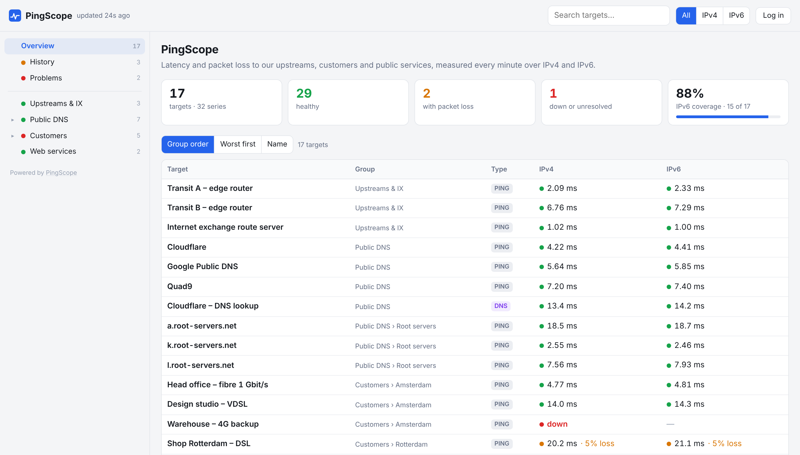

# PingScope

**Latency and packet-loss monitoring for IPv4 and IPv6, in the spirit of SmokePing, with a modern web admin panel.**



PingScope measures round-trip time and packet loss to your routers, customers, DNS servers and websites every minute, over **IPv4 and IPv6 side by side**. It draws SmokePing-style "smoke" graphs, runs **mtr traceroutes** when something goes wrong, and sends **alerts by Telegram and email**. Everything is configured in the browser.

- **Probes:** ping (fping), DNS query time, TCP connect time
- **IPv4 + IPv6** graphs next to each other, with A/AAAA lookups and IPv6 suggestions
- **SmokePing-style graphs** from 3 hours to a year, with crosshair, drag-to-zoom and click-for-traceroute
- **mtr traceroutes** every 15 minutes, every minute during problems
- **Alerts** by Telegram and email per group, with a preview and extra chats for customers
- **Public dashboard** without hostnames or IP addresses; Admin and Viewer accounts
- **SmokePing import**, JSON export, a single SQLite file for all data

Source code, screenshots and full documentation: **https://github.com/joebafra/PingScope**

## Quick start

```bash
docker run -d --name pingscope --restart unless-stopped \
  --network host --cap-add NET_RAW \
  -v pingscope-data:/data \
  -e TZ=Europe/Amsterdam \
  joebafra/pingscope:latest
```

Get the one-time setup code and open `http://<server>:8080/admin` to create your admin account:

```bash
docker logs pingscope 2>&1 | grep "setup code"
```

- `--network host` lets PingScope measure with the server's own IPv4 and IPv6 connectivity (Linux hosts).
- `--cap-add NET_RAW` is needed for ping (fping) and traceroutes (mtr).
- All data (settings, targets, measurements) is in `/data/pingscope.db`.

## Docker Compose

```yaml
services:
  pingscope:
    image: joebafra/pingscope:latest
    container_name: pingscope
    restart: unless-stopped
    network_mode: host
    cap_add: [NET_RAW]
    volumes:
      - ./data:/data
    environment:
      PINGSCOPE_LISTEN: 0.0.0.0    # 127.0.0.1 when a reverse proxy runs on the same host
      PINGSCOPE_PORT: 8080
      TZ: Europe/Amsterdam
```

## HTTPS

PingScope speaks plain HTTP. Put it behind a reverse proxy for HTTPS (Caddy, nginx, Traefik) and set `PINGSCOPE_LISTEN=127.0.0.1`. The installer in the GitHub repository sets up PingScope with Caddy and a Let's Encrypt certificate in one go: see the [install guide](https://github.com/joebafra/PingScope/blob/main/docs/INSTALL.md).

## Tags

| Tag | What it is |
|---|---|
| `latest` | The newest version on the `main` branch |
| `1.0.0-beta`, … | A release |
| `sha-<commit>` | One exact commit |

Images are built for `linux/amd64` and `linux/arm64`.

## Environment variables

| Variable | Default | Purpose |
|---|---|---|
| `PINGSCOPE_LISTEN` | `0.0.0.0` | Listen address |
| `PINGSCOPE_PORT` | `8080` | Port |
| `PINGSCOPE_DB` | `/data/pingscope.db` | Database file |
| `PINGSCOPE_TRUSTED_PROXIES` | `127.0.0.1` | Reverse proxies whose `X-Forwarded-*` headers are trusted |
| `PINGSCOPE_DOMAIN` | | Your hostname, used for links in alerts |
| `TZ` | | Time zone for logs and alert messages |
| `TELEGRAM_BOT_TOKEN` | | Telegram bot token (or set it in the admin panel) |
| `LETTERMINT_TOKEN` | | Lettermint API token for alert emails (or set it in the admin panel) |

Everything else (measurement interval, probes, alerts, users) is set in the admin panel.

## Useful commands

```bash
docker exec -it pingscope python -m pingscope create-admin                 # extra admin account
docker exec pingscope python -m pingscope backup /data/backup.db           # consistent database copy
docker exec -i pingscope python -m pingscope import /dev/stdin < Targets   # import a SmokePing config
```

## License

[MIT](https://github.com/joebafra/PingScope/blob/main/LICENSE)
